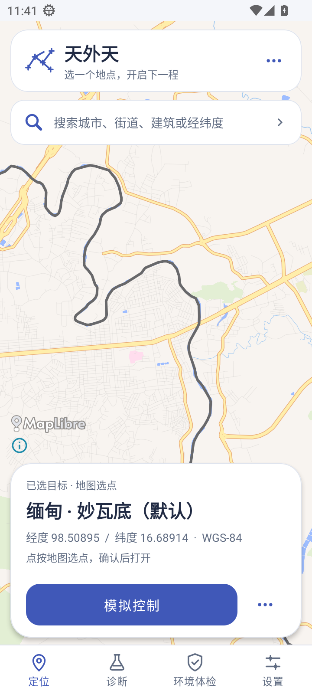
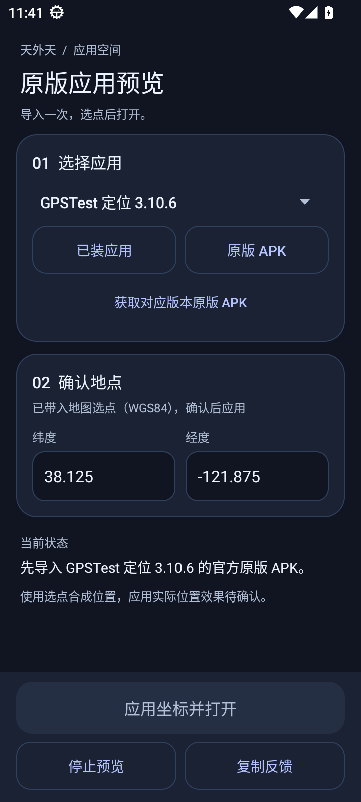
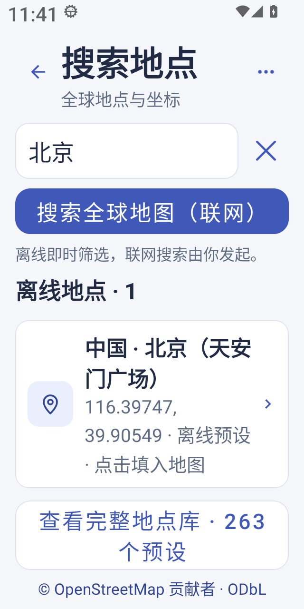
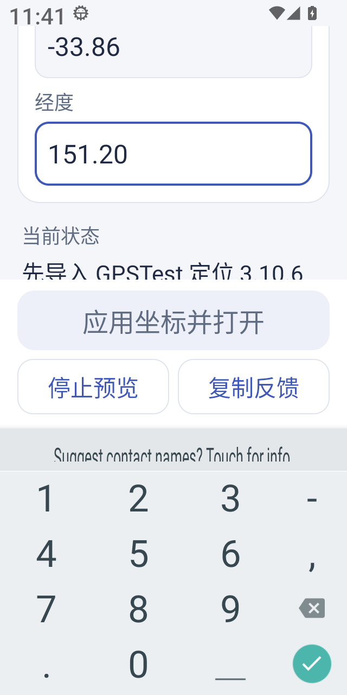

# 天外天 2.4.36 · 界面预览

地图主操作固定在底部，搜索与预览页统一配色、字阶、留白和浅／深色主题。小屏大字体保留完整点击区域，键盘弹出时收起页头，纬度、经度均可滚动输入。

以下是自有 Android 界面的原始截图，未裁剪或修改。四种配置的20个界面阶段已通过；当时尚未导入应用，因此预览页的打开按钮显示禁用。

## 地图首页

## 深色预览页

## 小屏与1.5倍字体

## 键盘弹出后的经度输入

截图来自运行源码 [87d5188f](https://github.com/soozooq/gogogo/tree/87d5188f32cf6b816a9f0f29696dd328b6e230b5) 的 [CI65](https://github.com/soozooq/gogogo/actions/runs/40866391127)，摘要见 [image-sources.json](image-sources.json)。CI65另有“已装应用导入后按钮启用状态”及外层收图仍按16张校验的失败，整轮失败、原生阶段跳过；界面通过不代表新安装包资格或微信／抖音定位业务通过。后续实际状态以 [项目接手入口](../../PROJECT_STATUS.md) 为准。

地图数据 © OpenStreetMap 贡献者（ODbL），地图服务／样式 OpenFreeMap，渲染 MapLibre；截图保留原署名与信息入口。
