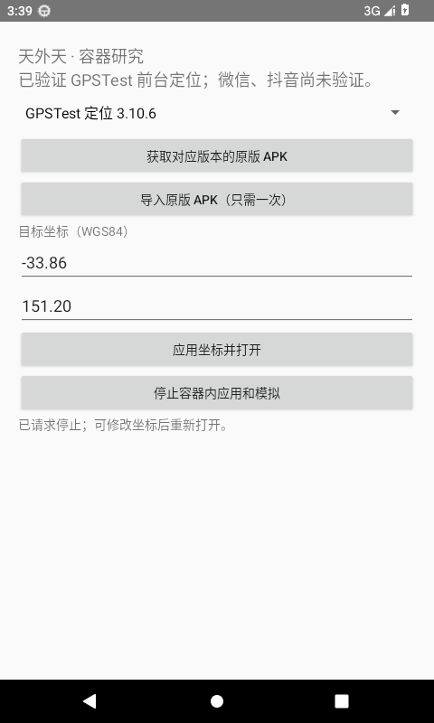
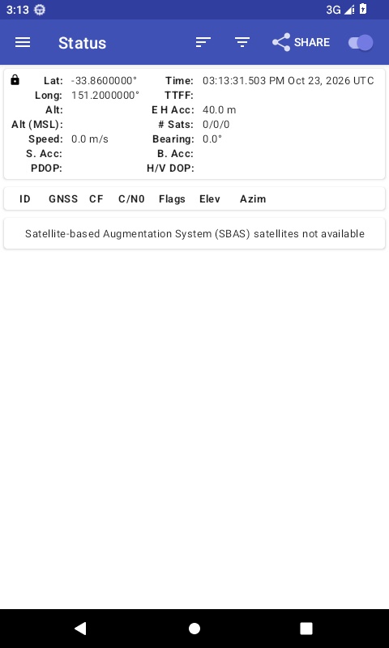
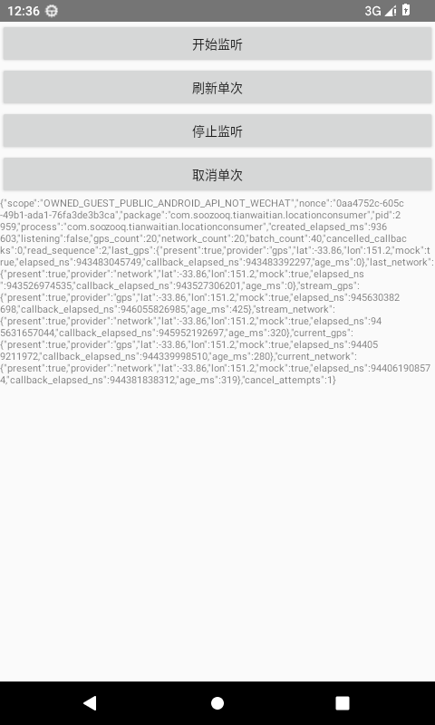
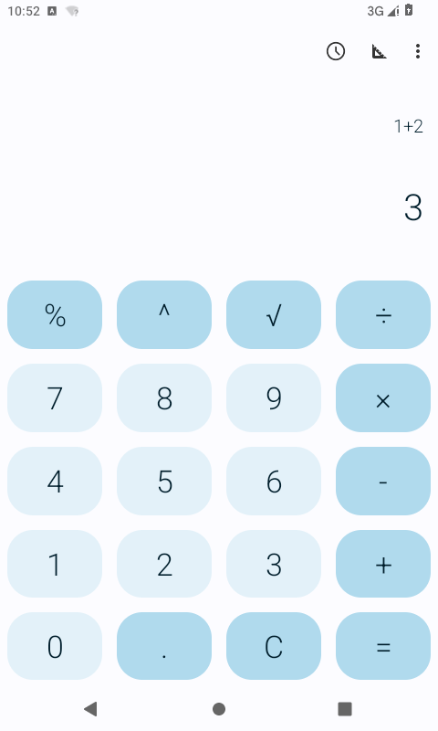

# Android13免Root容器与普通应用入口

唯一研发分支`research/container-api33-20261023`／Draft #60，日常#59固定2.4.31／2400099。当前以根[PROJECT_STATUS.md](../../PROJECT_STATUS.md)为准，不给单手机用户新增实验。

[CI47默认](evidence/persistent-phone-callback-results.json)实际六项／15受控无线与447项／lint通过，三档来源／签名／材料已核对；现代持续电话注册／旧缓存、六类回调交付时模式、原参数及同Binder注销均有受控证据，真实Guest注册／modem和目标SDK仍未由此证明。匹配原生121473513629执行中。

[CI46原生完整通过](evidence/native-owned-private-snapshot-pass-results.json)：两普通原包与两容器匿名UI、自有框架14.734秒、独立Guest六路径46.183秒及四阶段全部通过，系统／清理合格；四档及9份输入均核对。固定42cd5eb5／旧416补丁，不含新aad5持续电话变更。目标定位关闭，未接受条款／登录／发送，微信／抖音／海外和vivo业务仍未验收；44／45失败保留。

[手机草稿交付准备](evidence/phone-ci-draft-delivery-preparation.json)保留两份ff12自有APK，当前工作区上传401、草稿无附件。标准仓库CI将固定源码主包和按公开签名／ZIP元数据恢复的原私签预览写入同一草稿；私钥不离开本地，所有415压缩payload原样复制，真实SHA／证书／对齐及本地打包已核对。只保存两份自有APK及一个平铺下载包，不自动发布、不新增原生轮。等待远程交付及匹配原生，暂不要求手机安装／实验。

[反馈文案简化](evidence/no-extra-experiment-feedback-preparation.json)统一已有「一键复制反馈」，原权限／证据判定保留；高级检查供维护使用。[三步手机流程](../../docs/original-app-preview-flow.md)仍为预览说明，不宣称目标App采用。固定完整微信8.0.79／抖音40.8.0不改签、不内嵌、不分发，账号私有数据不迁移；原生ARM64与单手机无Root流程分别核对。

下方保留此前各轮的命令和历史结果，不替代顶部当前状态。[CI38匿名启动通过](evidence/native-container-startup-pass-results.json)、[CI40旧PID集合失败](evidence/native-pid-set-and-owned-stage-results.json)、[CI39真实Provider归属失败](evidence/provider-attribution-failure-and-correction.json)均保留，不覆盖为成功。

## 核对下载的 CI 回执（维护用）

`tools/verify-ci-receipts.py` 读取已下载的 ZIP，不安装应用、不查询手机。输入 JSON 填写 GitHub Artifact API 给出的完整提交、run ID及各归档摘要，路径指向本地 ZIP；支持 `linux`、`mac`、`own`、`native` 四种归档角色。摘要不能改成从待验证 ZIP 自行推导的预期值。输出使用一个尚不存在的新路径，保留旧证据。

```sh
python3 research/container-api33/tools/verify-ci-receipts.py \
  --inputs /path/to/api-artifact-inputs.json \
  --sdk "$ANDROID_SDK_ROOT" \
  --output /path/to/new-verified-receipt.json
```

输入形状为 `{"run_id": 123, "commit": "完整40位提交", "artifacts": {"linux": {"id": 456, "sha256": "API给出的64位归档摘要", "path": "/path/to/linux.zip"}}}`；其他角色按同样形状添加。校验归档路径、提交源码及完整自有传递清单、APK 摘要／签名／材料、主程序 XML 和各阶段记录，按固定 Git 提交取源码，因此保留历史回执时无需重置工作区。原生下载等准备失败保留错误、明确未达到运行阶段及未知清理；未提供原生回执记为 `NOT_SUPPLIED_NOT_PASS`，真实失败继续保留；`integrity_verified` 表示证据核对，不是微信／抖音或定位成功。参见[实际回执与负例准备记录](evidence/receipt-verifier-preparation.json)。

## 历史：ARM64 软件模拟与 Cuttlefish 前置核查

[实际 Linux 核查](evidence/full-arm64-software-linux-check.json)已越过启动器限制，在官方未修改的 API33 ARM64 镜像里读到 ARM64 内核／应用 ABI、Native Bridge 0、UID 2000、SELinux Enforcing。随后 ART／system_server 原生崩溃，完整启动未通过；新 CPU 配置和全新 AVD 也复现，目标应用与容器均未测试。

`tools/run-arm-mac-software-checks.sh` 的[实际核查](evidence/mac-arm64-tcg-selection-failure.json)显示，修正探测时的 SDK 库路径后，二进制确实列出 TCG；但最终 `accel=tcg` 参数未取消此前启用的 HVF，系统仍在启动前报 `HV_UNSUPPORTED`。这不是目标应用结果，也不能推断 TCG 没有实现。该工具默认关闭，只供运行条件变化后手动复核，不重复相同 Mac 参数。当前转向较新的官方 Google API33 ARM64 镜像；`qualify-arm64-software-boot.py` 要求完整启动和身份核验，未通过不得执行应用检查。不增加手机实验页或发布手机包。

[Google API33 ARM64 rev17 实测](evidence/google-api33-full-arm64-software-check.json)的两核和单核／单 TCG 线程均记录到两个不同 system_server 的 ART 原生崩溃，完整启动未通过，原版应用没有安装。单核沿用失败启动后的自有 userdata，不能称作另一份全新 userdata 证明；基础系统和 SDK 二进制均未修改。

[Google API32 ARM64 rev8 实测](evidence/google-api32-full-arm64-software-check.json)的全新 userdata／`max` 和标准 `cortex-a53` CPU 均在 ADB 就绪前发生 keystore2 原生崩溃循环，普通入口和目标应用未执行。新增 `qualify-arm64-software-boot.py --console-log <本 VM 启动日志>` 可从两个不同 PID 的真实原生崩溃头提前判失败；忽略同 PID 重复及等待服务的文字。后一例已自动停止检查，`0.0s` 是读取已有故障日志的检查耗时，不是系统启动耗时。前一例为观测故障后人工停止，不冒充自行退出。不重复相同 SDK 配置；当前只核查另一官方整机路径的源码前提，尚无新环境通过。

原包启动驱动新增显式 `--runtime full-arm64` 模式，API32／33 须明确选择：Python 和设备端驱动均要求完整启动、ARM64 内核与主 ABI、无 x86 ABI、Native Bridge 为 0、普通 UID 和 SELinux Enforcing；原有 API30／32 转译模式仍单独保留。尚未执行原包检查。普通入口／计算器驱动同样显式选择 API，原有自编定位契约仍限 API33；旧系统的 UI 测试读流改用有限缓冲，不依赖 API33 的 `readAllBytes`。通过环境核查后才可使用 `run-target-startup-check.py --runtime full-arm64 --api 32 --target wechat --label <新记录名>`，再测抖音；仍先验证系统普通安装，容器定位保持关闭，不接受条款或登录，不加入普通准入清单。

[Cuttlefish 源码前提](evidence/cuttlefish-arm64-feasibility.json)另有固定上游提交：ARM TCG 分支存在，不能把 SDK 失败扩大成所有整机路径均不可用。当前仅新增同一工作流内的原生 ARM Linux **宿主诊断**，默认关闭，手动选项或提交标记 `[cuttlefish-host]` 可触发；`inspect-cuttlefish-arm-host.py` 记录原生 QEMU、vhost-vsock 能力读取、局部 vsock 绑定与 tun 访问，不启动 Android、不下载 APK。必要设备准备只允许在该临时 GitHub runner 中执行。诊断收集成功和 `eligible_for_boot_attempt` 是不同字段，后续必须明确检查该字段，不能把绿色收集任务当作 Android／微信成功。只用独立实例路径，不覆盖 HOME。

已从官方公共 Artifact Viewer 下载同一 Android13 构建 `16596636` 的镜像、宿主工具与 manifest，[固定输入](cuttlefish-inputs.json)记录实际大小及本地计算的 SHA-256，不能冒充官方另行发布的校验和。配套 `assemble_cvd`／`run_cvd`／`cvd` 均为原生 ARM64；manifest 中对应 Cuttlefish 源码为 `4b46735a`。公共页面提供正常 Download 链接，不需要登录、API key 或交互认证，不保存临时签名链接。

同一 ARM Linux 作业新增独立选项 `run_cuttlefish_arm_boot`／提交标记 `[cuttlefish-boot]`，默认关闭。先检查真实宿主前提，再用配套 `assemble_cvd → run_cvd` 阶段、显式镜像／实例／汇总路径启动一台 VM；原生宿主 Bionic 工具使用独立 `ANDROID_DATA` 运行目录，保持 HOME。宿主适配器严格识别固定源码产生的单个 KVM／CPU 参数，并替换为 TCG／GICv2／MTE／`max,lpa2=off`，不修改内核、QEMU 或宿主二进制；原始下载归档保持固定，官方组装生成运行磁盘，userdata 后续正常写入。参数变化直接中止，不在末尾叠加冲突的加速器。另安装固定官方能力声明脚本，并独立核对实际设备能力，不把该声明当作能力证明。三个专用 TAP 使用独立接口，其中 mobile TAP 按配置服务要求提供本地 IPv4／广播；未配置 DHCP／NAT，不证明联网。

启动成功必须核对完整启动、实际 API33／构建号／Cuttlefish 产品／ARM64 内核与 ABI、无 Native Bridge、普通 shell UID 2000、SELinux Enforcing，以及存活 QEMU 的二进制摘要和完整有效参数。失败保存原因与本实例日志并停止。系统及原包证据产物只上传文本／截图，不包含目标原包或镜像。可选的自有宿主／测试对传递见文末，独立于手机候选发布。

可选的 `[cuttlefish-boot] [cuttlefish-startup]` 在同一驱动明确选择 `--original-baselines`：仅在本次系统身份完全合格后，复核存活 QEMU 和实际 ADB 身份，下载并核对两款既有固定原包，依次正常安装、读取欢迎／隐私页及清理。此阶段不需要 Android SDK 构建工具或研究宿主 APK，因此可在原生 ARM Linux 上运行；现有 SDK／容器驱动的设备限制没有放宽。失败或超时的安装也纳入清理，原先存在的系统包保持原状。宿主 Bionic 根目录、代理和 CA 环境一致传递给每次 ADB。只上传证据，没有登录、同意条款、点击应用界面或位置业务；不代表目标容器兼容。`tests/test_cuttlefish_target_baselines.py` 的四项受控检查及八种 ADB 情况本地通过，实际原包尚未执行。加上 QMP／明确致命日志识别共七项受控检查通过；系统未合格时不会下载或安装原包。

原生宿主工具的实际时区初始化故障已追到 manifest 对应的 [Bionic tzcode](https://android.googlesource.com/platform/bionic/+/6e03489e7a4ec5b34b202a3fa4f868a4fdfc3bda/libc/tzcode/bionic.cpp)：宿主分支依次使用 `ANDROID_DATA`、`ANDROID_TZDATA_ROOT`、`ANDROID_ROOT`，未设置会中止。当前使用独立可写缓存、真实宿主根目录及该宿主包自带的 tzdata，统一传给全部宿主子进程；先执行 avbtool／ADB 的正常版本预检。原始失败和修正前输入摘要保留，工具预检也不代替 Android 启动。

固定源码的 [ValidateHostConfiguration](https://android.googlesource.com/device/google/cuttlefish/+/4b46735a8d5b752ad77f4c518708024632495a2e/host/libs/vm_manager/host_configuration.cpp)另要求实际 `cvdnetwork`／`kvm` 组成员资格。工作流正常创建／加入这些组，再以同一个普通 runner 用户刷新补充组；主流程核对 UID 及实际组，VM 不以 root 用户运行。组名不提供 KVM 硬件；设备检查、有效 TCG 参数和无 KVM 的证据独立保留，没有修改或绕过该验证器。

[最新实际失败](evidence/cuttlefish-firmware-network-failure.json)已通过工具预检、真实组成员及系统组装；QEMU 加载网卡选件 ROM 时缺少发行版 `efi-virtio.rom`，配置服务也因 TAP 没有 IPv4 配置中止。内核没有启动；请求的 TCG 参数记录不等于已执行 Android。工作流补充 `ipxe-qemu` 包；依照固定 [host_device_config.cpp](https://android.googlesource.com/device/google/cuttlefish/+/4b46735a8d5b752ad77f4c518708024632495a2e/common/libs/device_config/host_device_config.cpp)，专用 mobile TAP 配置实际私有 IPv4／广播，先核对已有路由避免冲突，保留其他路由，不增加 NAT／DHCP或宣称互联网可达。驱动现在检查实际 QEMU 子进程与配置服务，ADB 连接短超时只记录次数；退出时通过 PID 句柄且核对原二进制与全部参数，仅清理本次 QEMU。

[后续实际运行](evidence/cuttlefish-audio-backend-failure.json)确认固件和网络配置已解决，仍在内核前因 `AC97: no default audio driver available` 退出。固定 QEMU manager 无条件加入 AC97，即使传入 `enable_audio=false`；适配器现严格核对该设备，再保留原 PCI 拓扑并指定 `AC97,audiodev=cvd_silent`／`-audiodev none,id=cvd_silent`，不依赖宿主声卡，不删除设备或修改二进制。完整实测 argv 转换及冲突参数本地检查通过，仍待真正启动结果。

## 已实测：统一的普通导入／选点入口

研究宿主现在用一个页面完成选择、导入、填坐标、打开与停止。固定计算器和 GPSTest 的清单从 `sources.json` 生成；导入核对原 APK 的大小、摘要、包名、版本、证书。已导入状态和目标会保留，修改坐标后直接再次应用；不会改动系统安装的微信、抖音或日常天外天。

[完整普通入口检查](evidence/unified-entry-results.json)通过 **63.652 秒**：真实系统文件选择器导入、精确定位授权、宿主界面设置 A→B、原版 GPSTest 同一进程更新，最后停止实际 Guest 进程并关闭虚拟模式。此检查没有直接调用引擎设置目标或用测试代理替代界面，输入绑定当时 24 项源码与 APK 摘要。中途一次文件选择器文字定位失败已分类保留；现在每轮清空自己的旧输出，失败不复用历史截图／报告。



该历史普通入口结果覆盖上述两个固定发布文件。本轮候选将[已核验的官方微信8.0.79／抖音40.8.0](evidence/official-target-apk-readiness.json)加入清单，限原生ARM64；已安装版本必须完全匹配，否则选择固定完整原版APK。计算器已装导入已通过，目标定位仍待实际验证；不改签或分发原包，也不等于用户手机版本已匹配。微信／抖音的定位、腾讯／字节SDK、GMS、海外及vivo仍未验证。

本云端 x86_64 模拟器[拒绝 ARM64 镜像](evidence/arm64-cloud-runtime-limit.json)。[GitHub ARM Mac 构建通过，VM 因 HVF 不可用未启动](evidence/cloud-arm-mac-build-and-vm-limit.json)。Linux 的 KVM 启动、存储和构建已通过，最近[文件选择器抽屉遮挡导致未完成选择](evidence/cloud-picker-occlusion-failure.json)，现改为默认下载目录并等待真实返回，已通过导入并实际打开 Guest；随后[首次启动更新说明遮挡坐标](evidence/cloud-fresh-gpstest-dialog-failure.json)，已按实际 XML 修正关闭按钮。[全新 KVM 普通流程 10.563 秒及计算器回归 5.778 秒通过](evidence/cloud-ordinary-entry-pass.json)，全部输入与实测提交逐项核对。失败不算引擎或定位结果。[云端流程](../../.github/workflows/container-research.yml)只上传证据，不上传 APK，继续研发统一留在 #60。

[官方 Google API33 x86_64 镜像实测](evidence/google-api33-nativebridge-check.json)没有 ARM64 转译。[官方 API30 镜像实测](evidence/google-api30-nativebridge-check.json)已确认内置 ARM64 转译、UID 2000 与 SELinux Enforcing。`tools/run-target-startup-check.py` 和独立云端 KVM 检查要求这一专用环境，固定两份官方目标原包，平台安装选项选择宿主 ARM64 ABI 并核对实际状态。它先普通安装对照，再容器匿名启动，保持定位关闭，停在欢迎或隐私页；不接受条款、不登录。[KVM 原包对照](evidence/official-target-baseline-limit.json)正常安装成功，但微信／抖音都在容器外发生原生崩溃，未达到欢迎／隐私页，容器未启动。微信的具体原因未定，抖音转译库报告 `Bad ubidi_openSized_66 call`。不将这算作容器或真机失败，也不重复相同 API30 环境。

另核对 [API31／32 官方镜像的局部元数据](evidence/api31-32-translation-metadata.json)，[API32 实际启动确认转译启用，但两款原包对照仍原生崩溃](evidence/official-target-api32-baseline-limit.json)，微信报告 `Cannot process signal 11`，抖音报告 `Bad ubidi_openSized_68 call`。容器没有启动，不能归因为容器或真机失败。

[默认 CI 的 Linux 构建／审计／普通入口／计算器回归和 ARM Mac 构建均已通过](evidence/default-ci-state.json)。目标转译预检改为手动选择、默认关闭，本次跳过；运行条件变化后再复核，跳过不算目标通过。失败记录完整保留，不重复相同环境。下一项技术前提是可正常运行原包的原生 ARM64 环境；当前没有连接用户手机。[官方模拟器宿主归档](evidence/official-emulator-host-archives.json)不列 Linux ARM64，ARM Mac 的 HVF 限制也仍在。此历史轮当时尚无目标启动通过；当前CI38已通过匿名启动，但定位和海外业务仍未通过。本轮候选普通清单已加入固定原包，运行结果待新CI。

## 前轮：官方 GPSTest 实际采用位置

未修改的官方 GPSTest `3.10.6 / 24100`（osmdroid）在系统未安装该包时进入容器，正常系统精确定位授权后，其实际坐标界面跟随 A→B 目标，31.322 秒通过。原 APK 的字节摘要及证书已核对；没有向 Guest 传入目标坐标，没有测试代理或直接调用 Hook。见[绑定 23 项源码摘要、实际界面文本及 JUnit](evidence/official-gpstest-location-results.json)。

真实应用暴露的 Android 13 GNSS 旧内部类崩溃已修正。API31+ 使用真实框架 GNSS 回调；虚拟会话只报告零颗卫星，不产生 first-fix、NMEA 或原始观测值。相关自有 Guest 回归通过六条定位路径、mock 标记与 GNSS 注销停止；4 项受控接口和原版计算器回归也通过。两次早期未通过的记录分别归类为引擎崩溃和自动化筛选错误，保留原输入，不当作成功。



**范围仍是一款第三方应用的前台定位采用，不代表腾讯／字节 SDK、GMS、微信／抖音、ARM64 或 vivo。** 日常应用及其手机安装包没有改变。该轮仍由云端驱动直接导入 GPSTest，后续普通入口验证见上节。

## 前轮：真实 Guest 中的自有定位调用

[独立的自有定位消费者](location-consumer/README.md)在系统未安装时，由容器在另一真实进程运行；通过普通 Android `LocationManager` 读取 GPS／NETWORK 的缓存、单次回调、持续更新。六条路径均跟随宿主设定的 A→B 目标，停止后计数稳定，取消后的回调为零。消费者不知道预期坐标，没有引擎、宿主或反射依赖；测试没有代理框架接口或直接调用 Hook。系统核验了不同 PID、共享宿主 UID。

[本轮结果](evidence/owned-guest-location-results.json)包含 18.919 秒通过的 JUnit、Guest 原始报告、全部输入摘要及两次早期自动化失败的分类。它覆盖真实 Guest 调用链，**仍是自编消费者，不能代表第三方 SDK、微信、抖音或 ARM64／vivo**。宿主 APK 与前轮相同，SHA-256 仍为 `e3131646a7d52c048cd6ed942492468e578f42d736075bb6b2ed52a288d1e1d0`；消费者和新测试 APK 分别绑定。此前证据保留原提交，不冒充新结果。



## 前轮基础：定位契约与原签名

[前轮结果（提交 4be23be）](evidence/api33-location-signature-results.json)绑定当时源码、补丁及宿主／测试 APK 摘要，覆盖：

- API 33 的公共 `LocationManager`：单次回调与取消、GPS／NETWORK 的新鲜且明确标记为模拟的样本、持续批量回调、注销、次数／时长限制及停用后释放，共 4 项受控检查通过。测试代理显式调用真实 Hook 入口，持续样本经过引擎的定位服务 Binder；**不包含真实 Guest 进程的 Hook 安装或第三方位置采用验证**。
- 原版计算器：系统未安装该包时，虚拟包管理器的 `GET_SIGNATURES` 与 `GET_SIGNING_CERTIFICATES` 均返回官方 APK 的原证书；真实界面的计算与从桌面重开保留结果再次通过。该项仍保持虚拟定位关闭。

本轮宿主 SHA-256 为 `e3131646a7d52c048cd6ed942492468e578f42d736075bb6b2ed52a288d1e1d0`。最初的 [results.json](evidence/results.json)、[source-snapshot.json](evidence/source-snapshot.json)和下方截图对应历史提交 `c134948`，保留原记录，不作为本轮 APK 的证据。微信／抖音／海外定位及 ARM64／vivo 仍未通过。

## 已观察到的能力

在 **Android 13 / API 33、x86_64 云端模拟器**中，未改动的 Fossify 计算器 `1.4.0 / 10` 完成了两项实际界面检查：

1. 系统正常安装的对照：通过可见按钮计算 `1＋2＝3`，回桌面后重新打开，结果仍为 `3`。
2. 系统未安装该软件时：研究宿主从固定 APK 导入并请求启动，真实计算器界面完成相同操作；检查前后 `pm path org.fossify.math` 均为空。

宿主不包含计算器 APK 或它的类定义，不要求计算器实现天外天接口。实际执行的是第三方 APK 的代码和资源，Android 窗口由宿主的 Activity 代理承载。Guest 与宿主共享 Linux UID 和权限，**这不是独立 UID 安全沙箱**。此结果仅覆盖这一款明确准入的软件及本轮流程。



截图为云端研究结果。微信、抖音、GPS／GMS 替换及海外地点功能均未在本轮验证。ARM64 已构建，尚无 ARM64／vivo 真机运行结果。

## 源码和修正

固定输入见 [sources.json](sources.json)：BlackBox `df6249da`、VirtualApp fork `b3c634ad`、原版 Fossify APK 的 SHA-256。两份候选均完成了云端构建；本轮的实际运行宿主使用 BlackBox。

[BlackBox 补丁](patches/blackbox-api33-build.patch)保留原来的 AIDL 包名及资源镜像修正，并加入现代定位回调、取消、调度／注销、时间戳和原签名修正。沿用同一个补丁文件和固定上游提交；已从原始文件重新应用并逐文件核对本轮结果。

研究宿主清除了引擎清单的大量权限继承，保留内部签名权限及 `REORDER_TASKS`，并为原版 GPSTest 增加普通的精确／粗略定位、网络、网络状态及前台服务权限。精确定位经过真实系统授权界面；Guest 共享宿主 UID／权限。普通入口保留固定计算器（定位关闭）与GPSTest，候选另准入原生ARM64的固定微信／抖音；应用坐标仅是设置虚拟会话，不证明应用采用。自有消费者仅用于云端回归。未开启 Root／Xposed 隐藏或守护服务。

## 尚未跨过的门槛

[API 与运行审计](AUDIT.md)区分已经修正并受控验证的接口，以及尚未完成的真实 Guest 定位、GMS、组件及权限兼容。此处的 UI 与接口结果均不能替代微信发送位置或实时共享成功。

[许可记录](THIRD_PARTY_NOTICES.md)及[运行时依赖声明清单](evidence/dependency-licenses.json)区分根许可证、传递依赖、原生代码和待补齐的发布材料。当前不将这份研究产物标为正式发行容器。

## 在研发环境复核

这些命令供云端／开发环境使用，不是手机用户的操作清单。准备 JDK 17，SDK 平台 30、33、34，Build Tools 33.0.2，NDK 25.1.8937393，CMake 3.22.1；设置对应的 `JAVA_HOME`、`ANDROID_SDK_ROOT`、`GRADLE_USER_HOME`，保留所在环境的代理及 CA 设置。SDK 安装串行完成，构建脚本禁止自动安装 SDK。

```bash
export CONTAINER_RESEARCH_WORKDIR=/tmp/gogogo-container-research-work
python3 tools/prepare.py --workdir "$CONTAINER_RESEARCH_WORKDIR"
bash tools/run-build.sh blackbox :BCore:assembleDebug :probeHost:assembleDebug :probeHost:assembleDebugAndroidTest :locationConsumer:assembleDebug :probeHost:writeResearchDependencyInventory
bash tools/run-build.sh virtualapp :app:assembleDebug
python3 tools/license-inventory.py --graph "$CONTAINER_RESEARCH_WORKDIR/evidence/runtime-dependencies.json" --gradle-cache "$GRADLE_USER_HOME" --output /tmp/dependency-licenses.json
python3 tools/inspect-apk.py --sdk "$ANDROID_SDK_ROOT" --host "$CONTAINER_RESEARCH_WORKDIR/probe-host-build/outputs/apk/debug/probeHost-debug.apk" --output /tmp/host-artifact.json
```

准备器将源码放到主仓库以外，固定提交与补丁；已有未知修改或不符的 APK 会保留并报错。构建前重新验证源码，不在默认天外天 Gradle 工程加入模块。

使用专用 API 33 x86_64 模拟器后，运行两项检查；脚本拒绝物理设备 serial，要求普通 shell UID 2000 与 SELinux Enforcing：

```bash
python3 tools/run-cloud-check.py --serial emulator-5580 --label installed-control --installed-baseline
python3 tools/run-cloud-check.py --serial emulator-5580 --label container-guest
python3 tools/run-cloud-check.py --serial emulator-5580 --label location-contract --location-contract
python3 tools/run-cloud-check.py --serial emulator-5580 --label owned-guest-location --guest-location
```

每轮使用独立且不允许覆盖的证据目录，记录源码／APK 摘要、真实界面、JUnit 原文和结束状态。正常安装仅用于第一项对照，之后移除；容器检查要求系统中不存在对应包。`--guest-location` 只在云端测试中准入本次独立构建并校验摘要的消费者，默认宿主入口的计算器准入规则不变。原始日志留在研究工作区，仓库只收录摘要、必要报告和云端截图。

[Cuttlefish 后续实际结果](evidence/cuttlefish-uboot-timeout.json)已进入 U-Boot 并显示 3GiB 内存，但限定等待后没有观察到 Linux／Android 启动或 ADB 就绪。QEMU 二进制／完整有效参数及存活状态已核对，最后由清理停止；不能写成完整系统运行或自发崩溃。

[Wi-Fi 核心修正实测](evidence/wifi-radio-privacy-contract-results.json)处理空值及关闭模式，采用 Android 标准脱敏副本、保留原对象、关闭时正常转发，移除固定路由器标识。新增三项加原基站共五项在 API33 x86_64 软件模拟器中 OK (5 tests)，1.335 秒；核对 35 项源码和两份 APK 摘要，VM 已停止。仅受控代理，没有真实 Wi-Fi 查询、Guest／SDK 采用或微信／抖音业务证明；旧 API 分支和 GitHub 独立回归另行验证。

GitHub `40102349634 / 24584ae` 的独立回归也已通过：五项基站／Wi-Fi 0.055 秒、普通入口 12 秒、计算器 5.543 秒及 ARM Mac 构建；已下载并核对 ZIP、提交及每轮全部 35 项源码。ARM 系统运行本次跳过，不当作通过。Cuttlefish 驱动通过 QMP 只查询状态、CPU、寄存器及数值 PC 的八个原始指令字（虚拟及物理只读），并记录 CPU 时间；不暂停、恢复、重置或改动 VM。`[cuttlefish-boot] [cuttlefish-diagnose]` 在同一作业选择 300 秒观测，软件运行按已测冷启动改为限定 2400 秒；该限制和观测结果均不替代 OS 资格检查。

[`40103018384 / 6ffc21e` 的实际诊断](evidence/cuttlefish-qmp-bootloader-stall.json)再次超时，五组寄存器完全相同，PC 为 `0xff86da00`，268.825 秒间增加 268.8 秒 QEMU 用户 CPU 时间。固件原始符号表与相同二进制已从 manifest 固定的 prebuilt 取得并核对。旧 U-Boot `get_tcr()` 使用有符号的 `(1 << 31)`，会将高位符号扩展；观测到的 X0 与此相符。QEMU 8.2.2 的 `max` 默认开启 LPA2，赋予 DS／描述符共享位新的地址含义。候选重定位下 PC 对应同步异常入口、LR 对应 `mmu_setup`；重定位和异常寄存器仍未直接读得，不能宣布根因确证。后续 `max,lpa2=off` 不改固件或镜像，实际结果见下段。

[最小原固件对照](evidence/uboot-lpa2-firmware-control.json)在相同 Ubuntu QEMU 8.2.2／AMD64 二进制及原始固件中，仅关闭 LPA2 即越过该卡点。默认模式全部寄存器与原生 ARM CI 完全相同；数值 PC 的虚拟读取失败，物理 32 字节匹配原固件 `vectors+0x200`。没有附加 Android 镜像／磁盘，后续因缺少环境而重置，不称为 Android 启动。所有本地 QEMU 已停止。实际后端不支持 `$pc`，也不提供 ARM 反汇编；现只读数值 PC 的原始字，按原输入离线解码。

[原生 ARM 后续实测 `40104761802 / de74ecd`](evidence/cuttlefish-post-firmware-anr.json)已进入 Linux 5.15.206 和 Android 服务，但网络栈服务执行 ANR 后被杀，引发 system_server Java `Lost network stack` 及 zygote 重启，完整启动未通过、原包未执行。ZIP、四项源码和实际 CPU 已核对，VM 已停止。新配置使用固定上游 `BootconfigArgsFromConfig` 的软件模拟超时倍数 50：上游仅按跨架构自动选择，本次同架构 TCG 适配遗漏该选择；通过受支持的 `extra_bootconfig_args` 请求，不改系统二进制或取消检查。Vendor init 将其映射到 `ro.hw_timeout_multiplier`，Build 读取，ActiveServices 的 20 秒服务时限乘以该值。系统资格新增核验实际值 50，外层 2400 秒仍有限定，明确系统进程 Java 致命异常／内核 panic 提前停止。该配置随后已独立通过系统资格，见下段；任何欢迎页也不等于微信／抖音业务成功。

[`40107227047 / 8311ed0` 的独立结果](evidence/cuttlefish-qualified-boot-install-timeout.json)已确认上述配置实际生效并通过完整系统资格。随后两款原包安装均在180秒超时；目标应用未启动，卸载失败及未记录安装会话的缺口如实保留，VM 已停止。当前安装驱动先等待 `am get-started-user-state 0` 返回 `RUNNING_UNLOCKED`，将禁用传输压缩的文件传输、远端 SHA256、标准 `pm install-create/write/commit` 分开计时保存回执与超时前输出，失败放弃本次已记录会话。单次安装阶段总等待限定1500秒；后续结果见下段，不由旧180秒超时推断传输或解析原因。

后续容器衔接使用明确的 `[cuttlefish-boot] [cuttlefish-container]` 标记，默认不执行：同一工作流 Linux 作业构建的自有宿主／测试对，以提交、完整研究源码和每份大小／SHA绑定，通过单日保留的独立 CI 产物传给 ARM 作业。仅含自有构建对与 manifest，原始微信／抖音不会进入该产物；它不是日常手机更新包。仍须先通过本次系统身份及该目标的普通安装对照，再调用既有匿名启动测试；CVD 模式再次核对固定构建／产品／安全状态，SDK 模式保留原限制。一个目标普通对照失败，只跳过该目标容器检查。首次实际 ARM64 导入和后续身份查询失败见最新结果；目标容器启动仍未通过。

[自有 APK 材料准备](evidence/ci-own-apk-materials-preparation.json)记录实际本地构建及检查：每份 APK 内保留11份许可／NOTICE／来源和相容库替换材料，字节与源码逐一匹配；两个 ABI 的实际 ELF 均有 `libxposed.so → liblsplant.so` 动态依赖。传递校验同时固定这些材料并拒绝嵌入其他 APK，13项受控驱动／材料检查通过。更改许可或来源材料也触发 CI。此材料包不是全部依赖逐文件许可审计或手机发行的完成证明，详见[来源记录](THIRD_PARTY_NOTICES.md)及[源码／库替换说明](CI_SOURCE_AND_RELINK.md)。

[历史 ARM 实测 `40143188975 / 5e87841`](evidence/cuttlefish-staged-install-and-runtime-limit.json)确认上述分阶段安装全部成功，提交耗时757.125／680.084秒；新鲜系统身份和两款启动请求均记录。微信欢迎 Activity 约131秒才出现，旧窗口120秒内未读到界面；抖音期间 `system_server` 的 `ApkAssets.finalize()` 10秒终结超时导致重启，包清理未确认，VM 已停止。保留原始 UNKNOWN，不把平台崩溃写成目标原生故障。

后续[四核实测 `40149216340 / 7a2eaf5`](evidence/cuttlefish-original-ui-and-package-identity-limit.json)保留了上述原包界面和容器身份查询结果。当前修正固定镜像归档接口所需的内部签名标志，并用自有宿主中的只读 instrumentation 指向自有测试 APK 的普通 Application，直接读取可见目标节点，避开 CLI 空闲等待且不初始化容器引擎；两份自有包清理后才进入容器。15秒构建及14项受控检查通过。首次本地自有界面对照未通过，现将变化界面放到独立自有消费者，并将读取检查加入默认 CI；[准备记录](evidence/nonidle-ui-and-signature-preparation.json)保留失败。修正后的读取、计算器及目标 ARM64 结果待取得。ART属性和看门狗均未修改。

## 当前框架启动修正

[准备记录](evidence/framework-startup-prerequisite-preparation.json)区分18秒构建及15项受控检查与尚待取得的实际 Guest／原包结果。宿主新增的 `ACCESS_WIFI_STATE`／`CHANGE_WIFI_STATE` 是固定系统 `WifiP2pManager.initialize` 强制要求的普通权限，未申请附近设备运行时权限或启用无线发现。旧 HTTP 支持使用平台真实共享库元数据；现代 PendingIntent 对系统按真实宿主身份创建，虚拟身份留在内部模型，不伪造系统 UID 或原包证书。自有框架检查只创建／取消 PendingIntent，没有验证发送或后台投递。

默认云端先运行自有变化界面、框架启动检查，再跑普通入口／计算器／无线代理。原生抖音普通对照与已经读到界面的容器各持续观察300秒，记录晚发异常和进程变化；容器执行总上限1200秒，系统身份、原包摘要／证书、JUnit和清理门槛保留。每个启动阶段先落盘，失败回执可复核。没有新增手机实验页或发布更新，微信实时位置、抖音无以太网与海外定位仍未完成。
